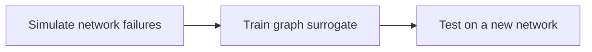

<h1>
  <picture>
    <source media="(prefers-color-scheme: dark)" srcset="assets/header-dark.svg">
    
  </picture>
</h1>

**I build machine learning systems for infrastructure reliability and document workflows.**

I study Civil Engineering at IIT Hyderabad. My current research explores whether graph neural networks trained on one infrastructure network can estimate earthquake-related failure risk on another.

## Featured projects

### [FlowForge · Visual ETL and scheduling](https://github.com/ajithreddy1234/FlowForge-ETL-Workflow-Automation-with-SQL-Assistant)

Build and schedule database-to-spreadsheet pipelines on a visual canvas. Includes versioned workflows, run logs, and a SQL assistant grounded in the database schema.

**Stack** · FastAPI, React Flow, Pandas, APScheduler, Docker · [Live sandbox](https://ajith-flowforge-scheduler.onrender.com/)

### [Invoice Exception Review](https://github.com/ajithreddy1234/Invoice-Exception-Review-and-Approval-Workflow)

Turns invoice PDFs into purchase-order decisions with a review queue for ambiguous or unreadable documents. Tracks partial billing and blocks duplicate commitments.

**Stack** · FastAPI, React, Supabase, Gemini, Tesseract · [Hosted app, reviewer sign-in](https://asa-invoice-review.onrender.com/)

### [Irrigation Demand and Reservoir Allocation](https://github.com/ajithreddy1234/demo-repo/tree/main/Irrigation-Water-Demand-ML)

Forecasts daily maize irrigation demand, then creates a release schedule subject to reservoir supply and daily capacity limits.

**Stack** · Python, XGBoost, linear programming

### [Promo Finder · Screenplay to edit shortlist](https://github.com/ajithreddy1234/kuku-promo-finder)

Proposes short clips from timed screenplays. Deterministic checks validate timestamps and scene boundaries before model-assisted review and ranking.

**Stack** · Python, FastAPI, React, Groq

### [Frontend Portfolio and Storefront](https://github.com/ajithreddy1234/ajith-frontend-portfolio)

Combines a project directory and a source-grounded assistant with a storefront that uses transactional checkout.

**Stack** · React, Vite, Netlify Functions, Gemini, PostgreSQL · [Live portfolio](https://ajith-reddy-frontend.netlify.app/)

<picture>
  <source media="(prefers-color-scheme: dark)" srcset="assets/divider-dark.svg">
  
</picture>

## Research · Seismic reliability

I represent infrastructure as a graph and use Monte Carlo simulations to estimate the probability that earthquake damage disconnects parts of it. I compare GraphSAGE and graph attention surrogates, then test how well they transfer to a new network. The aim is to make it faster to screen network layouts and identify where detailed simulation is worth the cost.

Research workflow

## Technical toolkit

-  **ML and deep learning** · PyTorch, scikit-learn, XGBoost · **Graph learning** · PyTorch Geometric, GraphSAGE, GAT
-  **NLP and document AI** · Sentence Transformers, FAISS, Gemini, Tesseract
-  **Backend** · FastAPI · **Frontend** · React, Vite · **Data** · PostgreSQL, Pandas · **Tooling** · Docker, pytest, GitHub Actions

## Find me

[Portfolio and project directory](https://ajith-reddy-frontend.netlify.app/projects.html) · [GitHub repositories](https://github.com/ajithreddy1234?tab=repositories)
