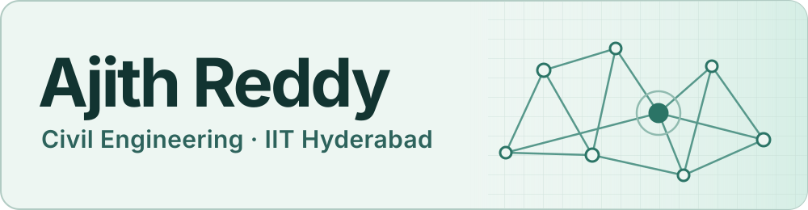

<h1>
  <picture>
    <source media="(prefers-color-scheme: dark)" srcset="assets/header-dark.svg">
    
  </picture>
</h1>

**I build machine learning systems for infrastructure reliability and software for document review.**

I’m a Civil Engineering student at IIT Hyderabad. My research uses graph learning to study how earthquakes affect infrastructure networks.

[Selected work](#selected-work) · [Seismic research](#seismic-reliability) · [Portfolio website](https://ajith-reddy-frontend.netlify.app/)

## Selected work

**[FlowForge](https://github.com/ajithreddy1234/FlowForge-ETL-Workflow-Automation-with-SQL-Assistant)** · A visual database-to-spreadsheet pipeline editor. Scheduled jobs run the saved workflow version they were assigned.  
FastAPI, React Flow, Pandas, APScheduler · [Try the sandbox](https://ajith-flowforge-scheduler.onrender.com/)

**[Invoice Exception Review](https://github.com/ajithreddy1234/Invoice-Exception-Review-and-Approval-Workflow)** · Turn invoice PDFs into purchase-order decisions. The workflow tracks partial billing against the same PO and routes ambiguous or unreadable invoices to a reviewer.  
FastAPI, React, Supabase, Gemini, Tesseract · [Hosted app (reviewer sign-in)](https://asa-invoice-review.onrender.com/)

**[Irrigation Demand and Reservoir Allocation](https://github.com/ajithreddy1234/demo-repo/tree/main/Irrigation-Water-Demand-ML)** · Forecast daily maize irrigation demand and use linear programming to plan releases within seasonal water and daily capacity constraints.  
Python, XGBoost

**[Promo Finder](https://github.com/ajithreddy1234/kuku-promo-finder)** · Generate an edit shortlist from timed screenplays. Code checks timestamps and scene boundaries before models assess the clips.  
Python, FastAPI, React, Groq

**[Frontend Portfolio and Storefront](https://github.com/ajithreddy1234/ajith-frontend-portfolio)** · A portfolio assistant that answers from project sources, with a storefront that commits checkout changes in a database transaction.  
React, Vite, Netlify Functions, Gemini, PostgreSQL · [View the project directory](https://ajith-reddy-frontend.netlify.app/projects.html)

## Seismic reliability

<picture>
  <source media="(prefers-color-scheme: dark)" srcset="assets/research-dark.svg">
  
</picture>

An earthquake can disconnect a network even when most of its links survive. I use Monte Carlo simulations to estimate that disconnection risk, then compare GraphSAGE and graph attention models trained on those estimates. I test how well the models transfer to a different network. The aim is to screen more layouts before running detailed simulations.

## Technical toolkit

-  **ML and graph learning** · PyTorch, PyTorch Geometric, scikit-learn, XGBoost
-  **NLP and document AI** · Sentence Transformers, FAISS, Gemini, Tesseract
-  **Software and data** · FastAPI, React, PostgreSQL, Pandas, Docker, pytest, GitHub Actions

[All GitHub repositories](https://github.com/ajithreddy1234?tab=repositories)
